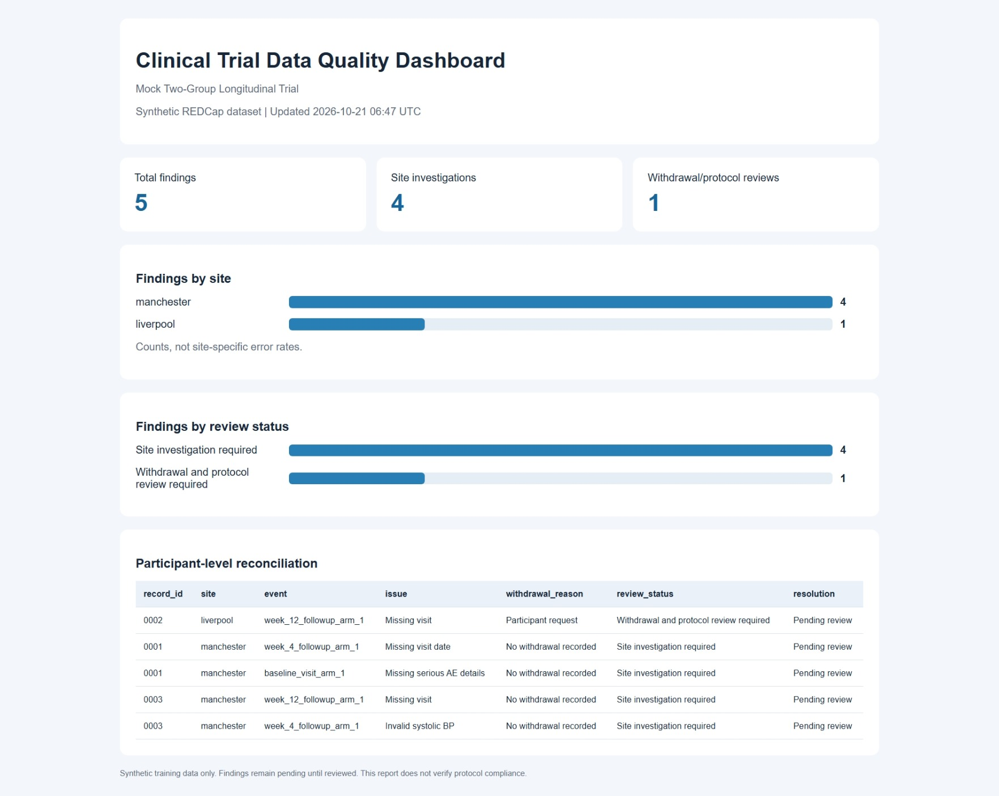

# REDCap Clinical Trial Data Quality Pipeline


A Python-based clinical trial data quality workflow integrating
REDCap API extraction, automated validation, site reconciliation,
HTML reporting, isolated execution and SHA-256 integrity checks.

The project uses a synthetic two-site longitudinal clinical trial
to demonstrate reproducible clinical data management processes.

## Dashboard Preview

The dashboard below was generated entirely from fictional,
synthetic clinical trial records. No real patient data is shown.



**Demonstration results:** 3 synthetic participants,
5 quality findings, 4 site investigation flags and
1 withdrawal/protocol review flag.

## Project Overview

Clinical trial data management requires accurate records,
consistent follow-up reporting, traceable discrepancies and
reproducible quality-control procedures.

This project provides an automated workflow to:

- Retrieve records from REDCap using a read-only API connection.
- Preserve participant identifiers and repeating instrument records.
- Detect missing visits and incomplete clinical documentation.
- Identify invalid systolic blood pressure values.
- Detect duplicate event-instance keys.
- Check Data Access Group consistency.
- Reconcile discrepancies with withdrawal information.
- Generate HTML data-quality reports.
- Archive individual executions with SHA-256 checksums.
- Run automated tests using independent synthetic fixtures.

## Technology Stack

- Python
- PyCap (REDCap API)
- pandas
- Requests
- python-dotenv
- unittest
- HTML reporting
- Git and GitHub

## Synthetic Trial Design

The demonstration dataset represents a fictional longitudinal
trial with:

- 20 participants
- Two study sites: Manchester and Liverpool
- Baseline, Week 4 and Week 12 visits
- Repeating adverse event records
- Withdrawal documentation

All demonstration records are synthetic.

## Data Quality Checks

The validation pipeline checks:

1. Missing expected study visits
2. Missing visit dates
3. Invalid systolic blood pressure values
4. Missing serious adverse event details
5. Duplicate event-instance identifiers
6. Inconsistent REDCap Data Access Groups

Findings are exported to a structured CSV report.

## Site Reconciliation

Discrepancies are combined with site and withdrawal information.

The reconciliation report distinguishes findings requiring
site investigation from findings requiring withdrawal
and protocol review.

Reconciliation classifications are review flags, not
automatic confirmation of protocol deviations.

## Pipeline Architecture

REDCap API
    |
    v
Read-only data extraction
    |
    v
CSV input snapshot
    |
    v
Data quality validation
    |
    v
Site reconciliation
    |
    v
HTML quality dashboard
    |
    v
Automated tests
    |
    v
Execution manifest and SHA-256 checksums

## Installation

Create a Python virtual environment and install dependencies:

```powershell
python -m venv .venv
.\.venv\Scripts\Activate.ps1
python -m pip install -r requirements.txt
```

For live REDCap extraction, create a local `.env` file containing:

```text
REDCAP_API_URL=your_redcap_api_endpoint
REDCAP_API_TOKEN=your_private_api_token
```

Do not commit `.env` or share API tokens.


## One-Command Synthetic Demonstration

The complete data quality workflow can be reproduced without
REDCap credentials or access to a clinical trial database.

After installing the project dependencies, run:

```powershell
python run_demo.py
```

The script automatically:

1. Loads an independent synthetic clinical trial fixture.
2. Creates an isolated execution directory.
3. Validates visit completeness and clinical data quality.
4. Reconciles findings with withdrawal information.
5. Generates an HTML data quality dashboard.
6. Executes 23 automated tests covering pipeline consistency and individual validation rules.

### Expected Demonstration Results

| Measurement | Expected result |
|---|---:|
| Synthetic participants | 3 |
| Trial records | 8 |
| Data quality findings | 5 |
| Site investigation flags | 4 |
| Withdrawal/protocol review flags | 1 |
| Automated tests | 23 passed |

The resulting dashboard is saved to:

`runs/demo_<timestamp>/output/quality_dashboard.html`

Each demonstration creates a new execution directory.
The `runs/` directory is excluded from Git.

All demonstration records are fictional and synthetic.
No REDCap connection is required.


## Run Standalone Tests

The repository includes a small synthetic fixture.

Run:

```powershell
python -m unittest discover -s tests -v
```

### Expanded Validation Test Coverage

The automated test suite includes 23 tests:

- 5 integration and pipeline consistency tests.
- 18 independent validation-rule tests.

The validation tests use temporary synthetic datasets
containing both valid and deliberately invalid records.

Scenarios include:

- Missing baseline, Week 4 and Week 12 visits.
- Missing visit dates.
- Systolic blood pressure below 80 or above 240 mmHg.
- Non-numeric blood pressure values and valid boundaries.
- Missing serious adverse event documentation.
- Valid and duplicate repeating instrument instances.
- Conflicting REDCap Data Access Groups.
- Missing required dataset columns.

All tests run without REDCap credentials.


These tests require no REDCap connection or API credentials.

The test suite verifies:

- Required data columns
- Event-instance uniqueness
- Preservation of four-digit participant identifiers
- Agreement between findings and reconciliation
- Withdrawal-related review classification

## Run the Live Isolated Pipeline

With REDCap API access configured:

```powershell
python run_live_isolated.py
```

The script creates a timestamped directory containing:

```text
runs/
  <run_id>/
    input/
      trial_data_<timestamp>.csv
    output/
      quality_findings_latest.csv
      reconciliation_report.csv
      quality_dashboard.html
    pipeline.log
    manifest.json
    checksums.json
```

Each run uses a separate input snapshot and output directory.

## Run the Offline Isolated Pipeline

To process an existing CSV in the local exports directory:

```powershell
python run_isolated.py
```

The offline pipeline does not connect to REDCap.

## Example Validation Results

A demonstration run containing 20 synthetic participants
and 61 exported rows identified three missing Week 12 visits.

Two findings required site investigation and one required
withdrawal and protocol review.

A separate eight-row synthetic fixture produces five
deliberately introduced quality findings.

These are demonstration results, not clinical trial outcomes.

## Data Integrity and Traceability

Archived executions include:

- A run identifier
- An execution manifest
- The input dataset filename
- A SHA-256 input fingerprint
- Pipeline execution logs
- Generated reports
- File checksums

Checksum verification detects subsequent file changes
relative to the saved checksum baseline. It is not
a substitute for an independently secured audit trail.

## Security and Confidentiality

The repository is intended for synthetic demonstration data.

Local credentials, API exports, run histories, backups and
Python environments are excluded through `.gitignore`.

Do not use identifiable patient records in public fixtures,
screenshots, example logs or Git commits.

## Limitations

- Validation thresholds are demonstration rules.
- Withdrawal flags require human review.
- The dashboard provides descriptive quality reporting.
- Production deployment would require appropriate access
  controls, governance and validated operating procedures.
- The current workflow is not presented as a certified
  clinical trial management system.

## Project Status

Implemented and locally tested:

- Read-only REDCap extraction
- Data quality validation
- Site reconciliation
- HTML reporting
- Offline and live isolated execution
- Independent synthetic automated tests
- SHA-256 archive verification

## License

No license has been selected yet.
